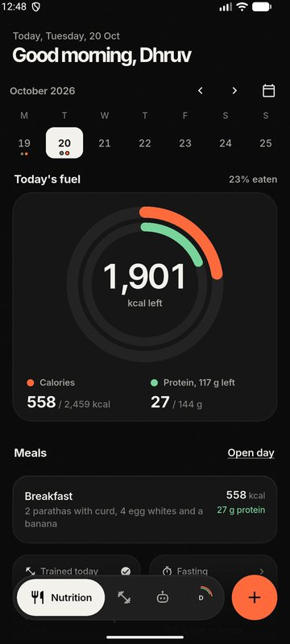
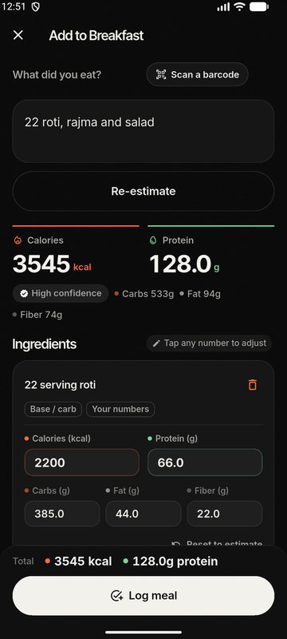
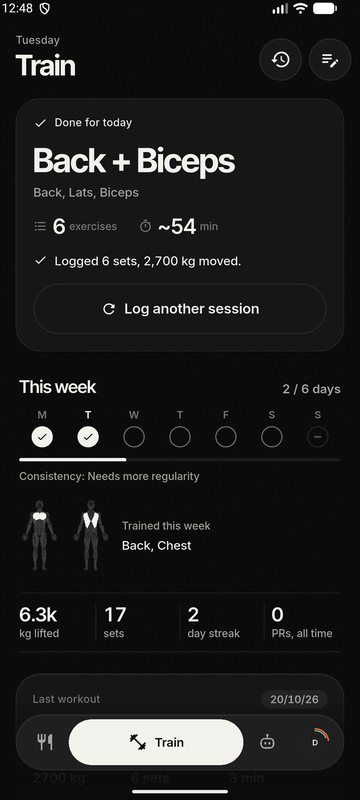
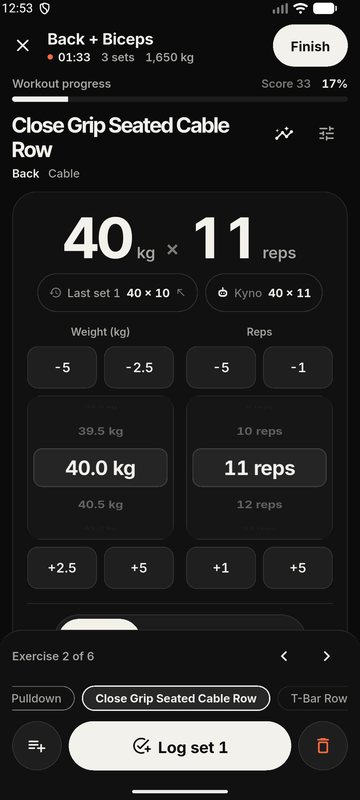
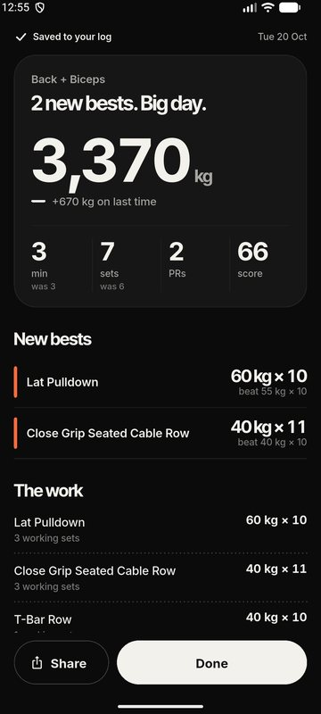
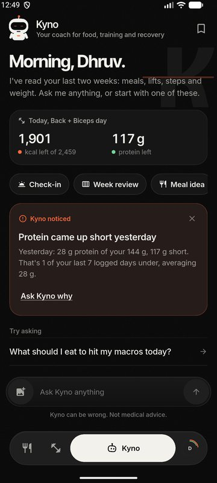
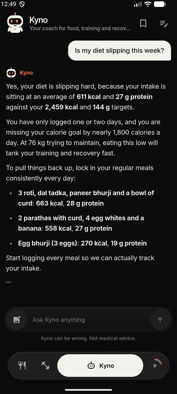
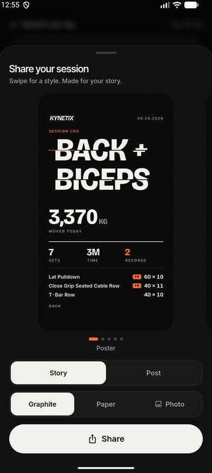
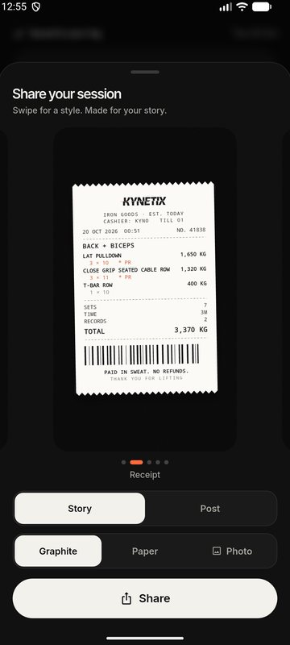
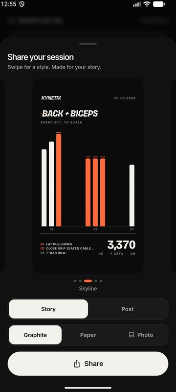

<p align="center">
  <picture>
    <source media="(prefers-color-scheme: dark)" srcset="docs/brand/kynetix-wordmark-dark-theme.svg">
    <source media="(prefers-color-scheme: light)" srcset="docs/brand/kynetix-wordmark-light-theme.svg">
    
  </picture>
</p>

<h3 align="center">Real food. Real lifts. One coach.</h3>

<p align="center">
  Log what you actually ate, in your own words. Log what you actually lifted.<br>
  Kyno, the coach, connects the two.
</p>

<p align="center">
  <a href="https://dhruvgupta-24.github.io/Kynetix/">Website</a> ·
  <a href="https://dhruvgupta-24.github.io/Kynetix/privacy/">Privacy</a> ·
  <a href="https://dhruvgupta-24.github.io/Kynetix/terms/">Terms</a> ·
  <a href="https://dhruvgupta-24.github.io/Kynetix/delete-account/">Delete account</a>
</p>

<p align="center">
  
  
  
</p>

<p align="center"><b>Status:</b> launching on Google Play soon. iPhone later.</p>

---

## A look around

<table>
  <tr>
    <td align="center"><br><sub>Today, at a glance</sub></td>
    <td align="center"><br><sub>Type it like you'd say it</sub></td>
    <td align="center"><br><sub>Your split, your week</sub></td>
  </tr>
  <tr>
    <td align="center"><br><sub>Sets, reps, rest. Done.</sub></td>
    <td align="center"><br><sub>Paid in sweat. No refunds.</sub></td>
    <td align="center"><br><sub>Ask Kyno anything</sub></td>
  </tr>
  <tr>
    <td align="center"><br><sub>Straight answers, real numbers</sub></td>
    <td align="center"><br><sub>Share card: Poster</sub></td>
    <td align="center"><br><sub>Share card: Receipt</sub></td>
  </tr>
  <tr>
    <td align="center"><br><sub>Share card: Skyline</sub></td>
    <td></td>
    <td></td>
  </tr>
</table>

---

## What it does

**Food**
- Log meals in your own words. "2 roti, 1 katori dal, some aloo sabzi" works. So does hostel mess food.
- Indian portions are first class: katori, roti, bowls, pieces, plates.
- Barcode scanning for packaged food (Open Food Facts), plus your own saved products.
- Calories and protein rings, with daily targets that follow your training days.
- It learns from your edits. Fix a meal once and it remembers.

**Training**
- Splits, sets, reps, rest timers, supersets, warm-ups.
- PRs detected for you, with a small celebration you earned.
- History, progression charts and a muscle map of what you actually trained.

**Kyno, the coach**
- An AI coach that reads your food and your training together, so "why do my lifts feel heavy" gets an answer that knows you ate 900 kcal yesterday.
- Send a photo of a plate or a menu and ask what fits.
- Optional: connect your own ChatGPT account to power Kyno.
- Kyno can be wrong. It is not medical advice, and it says so.

**Share cards**
- Finish a workout, pick a style: Poster, Receipt, Skyline, In real terms, Sticker. Post it. Be insufferable.

**Widgets**
- Home screen widgets in four sizes, so you can check your rings without opening anything.

**Health Connect**
- Reads steps, weight, sleep and HRV. Read only. Kynetix never writes to Health Connect.

**Feedback**
- Send feedback from anywhere in the app. It lands in a real inbox, read by a real person.

**Privacy**
- Your rows are yours: user data sits behind Postgres row level security.
- Delete your account from inside the app, or from the [web page](https://dhruvgupta-24.github.io/Kynetix/delete-account/). It actually deletes.

---

## How it's built

| Layer | What |
| --- | --- |
| App | Flutter (Dart), Android first. Plain `setState`, local cache in SharedPreferences, sessions in secure storage. |
| Data | Supabase Postgres with row level security on user data. Supabase Auth. |
| Server | Supabase Edge Functions (Deno, TypeScript). |
| AI | Gemini, then Groq, then OpenRouter free models as fallback. Or the user's own ChatGPT, if they link it. |
| Food data | Built-in Indian food knowledge plus Open Food Facts for barcodes. |

```
  Flutter app (kynetix_ui)
     |            |                          |
     |            v                          v
     |      Supabase Auth            Supabase Postgres (RLS)
     |                                        ^
     v                                        |
  Supabase Edge Functions  -------------------+
     |-- ai-chat-router     auth, per-user rate limits, provider fallback
     |-- ai-meal-coach      builds Kyno's context from your logs
     |-- delete-account     wipes your data and your login
     |-- openai-link-*      optional "connect your ChatGPT" flow
     v
  Gemini -> Groq -> OpenRouter (free models)
```

AI keys live only on the server. The app ships with no provider keys. Every AI call goes through `ai-chat-router`, which checks who you are, caps request size, and enforces per-minute and per-day limits per user.

---

## Run it locally

You need Flutter (stable, 3.41.x is what it's built on), the Android SDK, and a device or emulator. Your own Supabase project if you want the backend.

```bash
cd kynetix_ui
flutter pub get
```

Two config files are gitignored. Copy the templates and fill them in:

```bash
cp lib/config/supabase_secrets.example.dart lib/config/supabase_secrets.dart
cp lib/config/secrets.example.dart lib/config/secrets.dart
```

- `supabase_secrets.dart` needs your Supabase project URL and its anon (publishable) key. Nothing else.
- `secrets.dart` stays empty. The app holds no AI keys on purpose.

Then:

```bash
flutter run
```

**Backend (optional).** Schema lives in `supabase/migrations`, functions in `supabase/functions`. AI provider keys are Supabase secrets, never app config:

```bash
npx supabase db push
npx supabase secrets set GEMINI_API_KEY=... GROQ_API_KEY=... OPENROUTER_API_KEY=...
npx supabase functions deploy ai-chat-router
```

**Tests.**

```bash
cd kynetix_ui
flutter test
```

Edge function tests (shared helpers) run with `deno test` inside `supabase/functions`.

---

## Project layout

```
kynetix_ui/            Flutter app
  lib/screens/         Home, meals, training, Kyno, profile, onboarding
  lib/services/        Nutrition pipeline, workout engine, Kyno, Health Connect, sync
  lib/widgets/         Share cards, charts, muscle map, sheets
  lib/config/          Theme and the (gitignored) secrets files
  android/             Native bits, including home screen widgets
  test/                Unit and widget tests
supabase/
  functions/           Edge functions (ai-chat-router, ai-meal-coach, delete-account, ...)
  migrations/          Postgres schema and RLS
  templates/           Auth email templates
site/                  The website (GitHub Pages): landing, privacy, terms, delete account
docs/                  Design notes, screenshots, brand assets
```

---

## Privacy and data

Short version: we keep what's needed to run the app, nothing gets sold, and deletion is real.

- [Privacy policy](https://dhruvgupta-24.github.io/Kynetix/privacy/)
- [Terms](https://dhruvgupta-24.github.io/Kynetix/terms/)
- [Delete your account](https://dhruvgupta-24.github.io/Kynetix/delete-account/)

---

## Roadmap

- [ ] Google Play launch. Soon.
- [ ] iPhone. Later. It's on the list, not on the calendar.

---

## Contact

Found a bug? Got an idea? Use feedback in the app, or write to **kynetix.app@gmail.com**.

Built and run by Dhruv Gupta.

---

## License and credits

The source is public to read. There is no open source license yet, so all rights are reserved for now.

- Fonts: [Inter](https://rsms.me/inter/), Inter Tight and [Bricolage Grotesque](https://github.com/ateliertriay/bricolage), under the SIL Open Font License. License files ship in `kynetix_ui/assets/fonts/`.
- Barcode product data: [Open Food Facts](https://world.openfoodfacts.org/), available under the Open Database License (ODbL).
- More third party notes in [`kynetix_ui/NOTICE.md`](kynetix_ui/NOTICE.md).
